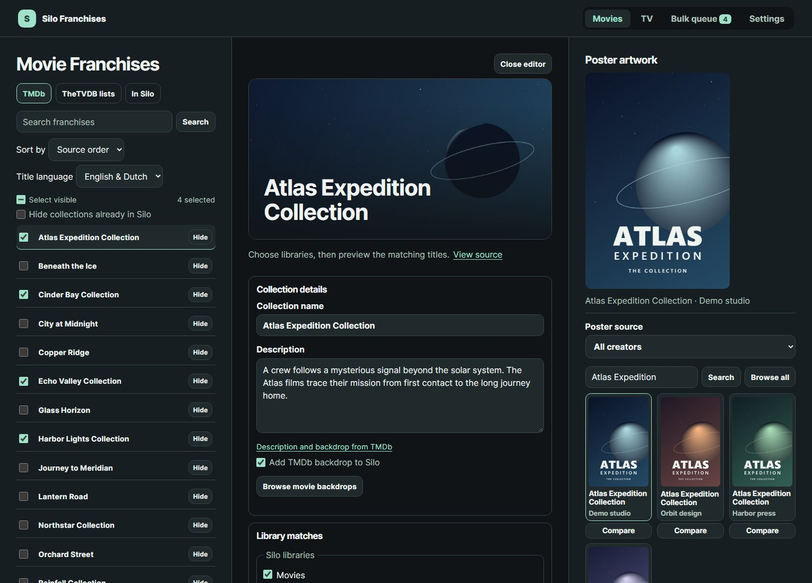
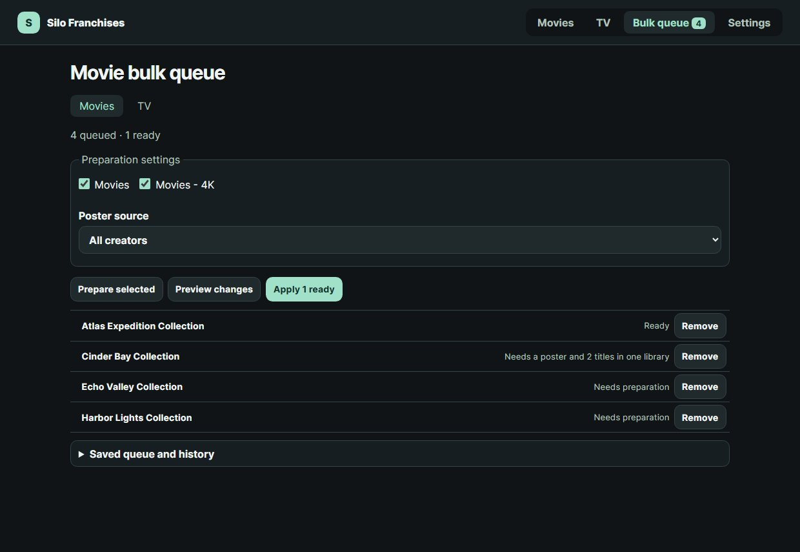
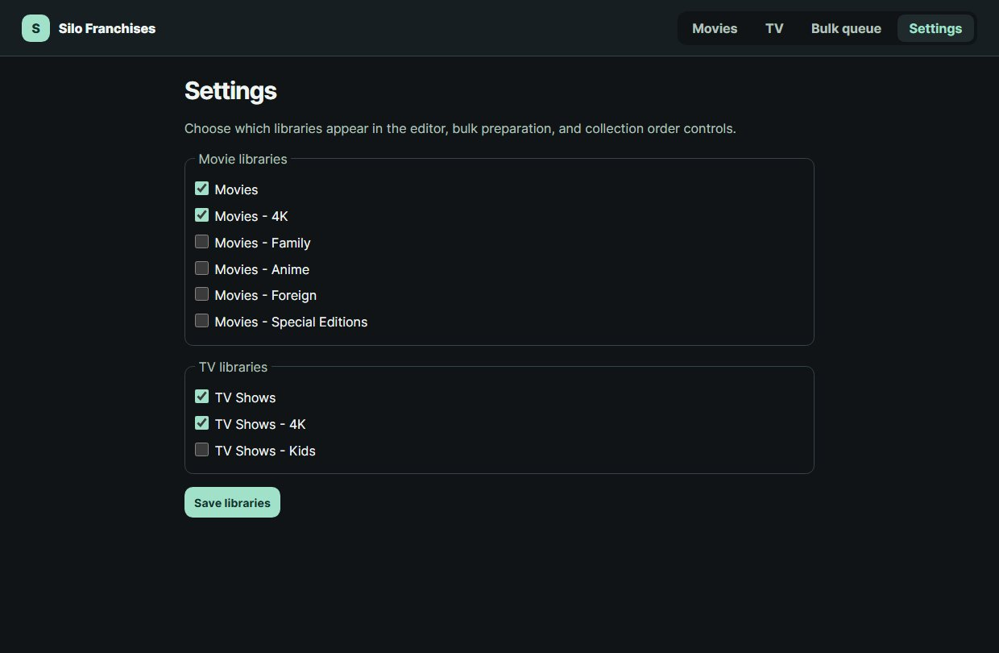

# Silo Franchises

A free, self-hosted companion to Silo for building and maintaining movie and TV franchise collections.

## Features

- Browse TMDb movie collections and official TheTVDB lists in a page-numbered editor. Filter by English or Dutch titles, hide franchises, and choose from all enabled movie and TV libraries in Settings.
- Preview franchise matches across selected libraries, fix ambiguous matches, and save library presets. Franchise imports require at least two distinct titles in an eligible library.
- Open **Custom collection** to search selected movie and TV libraries and hand-pick titles for a single manual Silo collection. The collection is assigned to the selected libraries and supports an optional poster URL.
- Browse and compare English-language artwork from ThePosterDB, paste a custom poster URL, or select movie backdrops from TMDb.
- Create and edit manual collections, or create TMDb-synced movie collections. Sort collection cards A–Z in Silo and undo recent metadata or artwork edits.
- Prepare, preview, and apply bulk changes on dedicated movie and TV queue pages. Drafts save to the server and can be resumed from another device.
- Review collection health, request missing titles through Silo Requests, and optionally add them to manual collections once they reach a selected library.

## Screenshots

The screenshots use fictional collections, libraries, and artwork.

### Collection editor

### Bulk queue

### Library settings

## Quick start

1. Clone this repository or create a **Git repository** stack in Portainer with `compose.yaml`.
2. Set `SILO_URL` to your server address, `SILO_API_KEY` to a Silo key with catalog and collection access, and `TMDB_READ_TOKEN` to your TMDb API Read Access Token.
3. Choose an `APP_PASSWORD` of at least 16 characters. `APP_USER` defaults to `admin`. For local Compose, copy `.env.example` to `.env` and fill in the values before starting.
4. Use an existing Docker network named `proxy`, or create it with `docker network create proxy`. Deploy the stack or run `docker compose up --build -d`. The app binds to `127.0.0.1:8088` by default. An HTTPS reverse proxy on the `proxy` network can forward to `silo-franchises:8080`.

Set the optional `MDBLIST_API_KEY` environment variable to enable **Search MDBList** in the custom collection editor. Choosing a public list finds matching titles across the enabled movie and TV libraries and selects the libraries that contain matches.

The `poster-index` volume stores artwork indexes, drafts, settings, and history. For requests, enable Silo Requests and configure fulfillment in Silo. Set `SILO_REQUEST_API_KEY` to a profile-bound key with the `requests` scope if the collection key lacks permission.

## License

The app is released under the [MIT License](LICENSE). Poster artwork and provider metadata are subject to the respective providers’ terms.

Uses [Silo](https://github.com/Silo-Server/silo-server), [TMDb](https://www.themoviedb.org/), [TheTVDB official lists](https://thetvdb.com/lists), and [ThePosterDB](https://theposterdb.com/).
